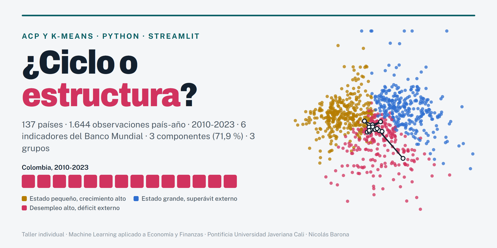
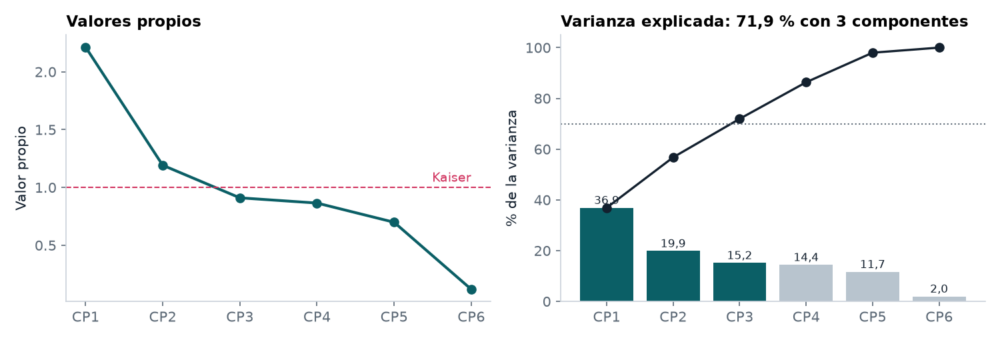
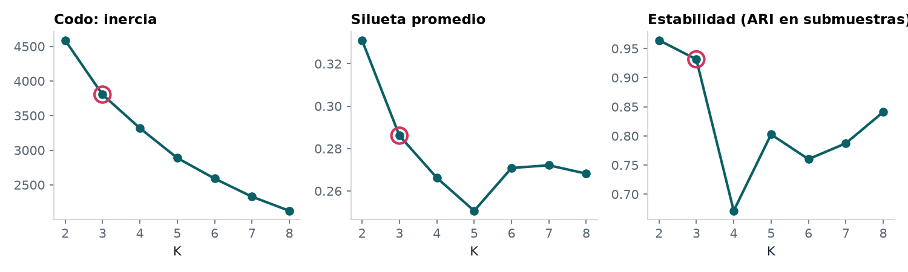
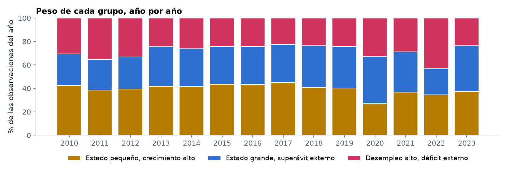
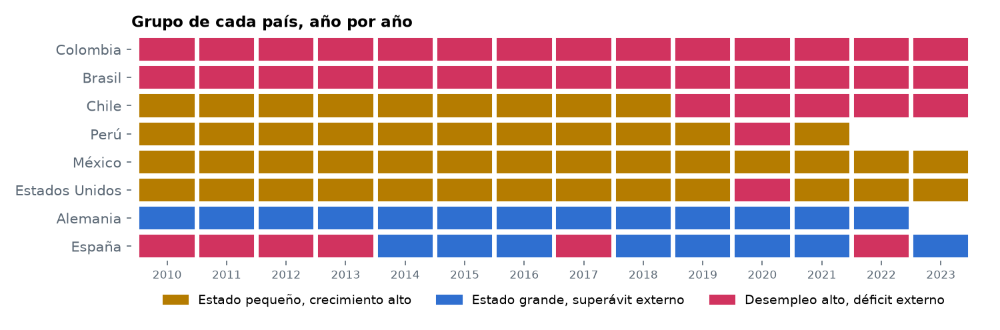
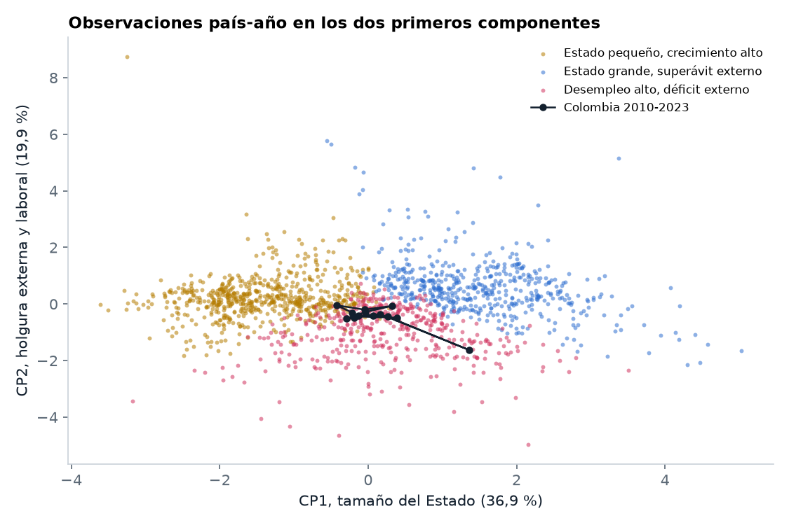

# ¿Ciclo o estructura? Regímenes macroeconómicos 2010-2023 con ACP y K-Means

Taller individual de Machine Learning aplicado a Economía y Finanzas, Pontificia Universidad Javeriana Cali. Nicolás Barona.

| Entregable | Enlace |
|---|---|
| Aplicación desplegada | [regimenes-macro-2010-2023.streamlit.app](https://regimenes-macro-2010-2023.streamlit.app) |
| Video de sustentación | pendiente: enlace del video |
| Repositorio | [github.com/nicobarona17566-prog/regimenes-macroeconomicos-acp-kmeans](https://github.com/nicobarona17566-prog/regimenes-macroeconomicos-acp-kmeans) |

En una frase: al agrupar 1.644 observaciones país-año por seis indicadores macroeconómicos, lo que separa a las economías es su estructura (el tamaño del Estado y la combinación de desempleo y cuenta corriente) más que el momento del ciclo; el 87,9 % de las veces un país sigue al año siguiente en el mismo grupo, y Colombia pasa sus catorce años en el grupo de desempleo alto y déficit externo.

## Pregunta y contexto

Cuando se compara la macroeconomía de dos países se mezclan dos cosas: el momento del ciclo (expansión, recesión, inflación alta) y la estructura (tamaño del Estado, posición externa, mercado laboral), que cambia despacio. El trabajo pregunta cuál de las dos domina cuando se agrupan los países sin categorías impuestas. Si los grupos son estados del ciclo, los países deberían pasar de uno a otro con los años; si son tipos de economía, cada país debería quedarse casi siempre en el mismo grupo.

Cada observación es un país en un año. Un solo país ofrece 14 años, muy pocos para estimar componentes y grupos con seis variables; el panel reúne 1.644 observaciones de 137 países y, además, permite contar cuántas veces cambia de grupo cada país, que es justamente lo que separa al ciclo de la estructura.

El ACP es pertinente porque los seis indicadores comparten información (ingreso y gasto público se mueven juntos; desempleo, inflación y crecimiento responden a los mismos choques) y conviene resumirla en pocas dimensiones antes de medir distancias. K-Means busca perfiles típicos sin etiquetas previas y, con la dimensión temporal, permite medir la permanencia de cada país en su grupo.

## Datos

La base (`data/world_bank_data_2025.csv`) es un extracto de los Indicadores del Desarrollo Mundial (WDI) del Banco Mundial: 3.472 filas, 217 economías, 2010-2025 y 13 indicadores, sin duplicados ni agregados regionales. Para comprobar el origen se descargaron de la API del Banco Mundial seis indicadores para Colombia: entre 11 y 14 de los 14 años coinciden exactamente, y las diferencias restantes (menores al 1 %, salvo la tasa real) son revisiones posteriores del Banco (`scripts/verificar_fuente.py`, `resultados/verificacion_fuente.csv`). El nombre en español, la región y el nivel de ingreso de cada país (`data/paises.csv`) vienen de la misma API.

| Variable | Código WDI | Uso |
|---|---|---|
| Inflación al consumidor (% anual) | FP.CPI.TOTL.ZG | Modelo, con logaritmo con signo |
| Crecimiento del PIB real (% anual) | NY.GDP.MKTP.KD.ZG | Modelo |
| Desempleo, % de la fuerza laboral (OIT, modelado) | SL.UEM.TOTL.ZS | Modelo |
| Saldo de cuenta corriente (% del PIB) | BN.CAB.XOKA.GD.ZS | Modelo |
| Ingresos del gobierno central sin donaciones (% del PIB) | GC.REV.XGRT.GD.ZS | Modelo |
| Gasto del gobierno central (% del PIB) | GC.XPN.TOTL.GD.ZS | Modelo |
| Tasa de interés real | FR.INR.RINR | Opcional (50 % de cobertura) |
| Ingresos tributarios (% del PIB) | GC.TAX.TOTL.GD.ZS | Opcional (repite el ingreso público) |
| Inflación por deflactor del PIB | NY.GDP.DEFL.KD.ZG | Opcional (repite la inflación) |
| Deuda del gobierno central (% del PIB) | GC.DOD.TOTL.GD.ZS | No entra (24,5 % de cobertura) |
| PIB per cápita (US$ corrientes) | NY.GDP.PCAP.CD | Solo para describir los grupos |
| PIB e ingreso nacional bruto (US$ corrientes) | NY.GDP.MKTP.CD, NY.GNP.MKTP.CD | No entran (miden tamaño; correlación de 1,0) |

Limitaciones de la fuente: aunque el archivo dice 2025, los datos útiles terminan en 2023 (en 2024 solo hay inflación y desempleo para parte de los países, y 2025 está vacío). Las cifras fiscales cubren solo al gobierno central, lo que subestima el tamaño del Estado en países federales como Estados Unidos, y faltan para muchos países de ingreso bajo, así que el panel no es balanceado. El desempleo es una estimación modelada de la OIT y no capta la informalidad.

## Metodología

Preparación (vista Preparación de la aplicación y `regimenes/preparacion.py`):

1. Ventana 2010-2023.
2. Seis variables: precios, actividad, empleo, sector externo y política fiscal.
3. Casos completos, sin imputación: 3.038 observaciones en la ventana, 1.650 con las seis variables.
4. Regla de anómalos: se apartan las observaciones con ingreso o gasto público por encima del 80 % del PIB o con cuenta corriente mayor al 60 % del PIB en valor absoluto. Aparta 6 observaciones, todas de Timor-Leste 2010-2015, con ingresos públicos de hasta 345 % del PIB. Quedan 1.644 observaciones de 137 países.
5. Logaritmo con signo en la inflación, ln(1 + |x|) con el signo de x, para que unas pocas inflaciones extremas no definan un componente: en el panel del modelo la inflación llega a 155 % (Líbano, 2021) y en la base completa a 557 % (Zimbabue, 2020).
6. Estandarización a media 0 y desviación 1.

ACP sobre la matriz de correlaciones, con cargas calculadas como vector propio por la raíz del valor propio y signos orientados para que la carga más grande de cada componente sea positiva. Se comparan el criterio de Kaiser, el umbral del 70 % y el gráfico de sedimentación.

K-Means (`n_init = 10`, semilla 42) sobre los componentes retenidos, con K de 2 a 8. Para elegir K se usan tres criterios: el codo de la inercia, la silueta promedio y la estabilidad. La estabilidad es el índice de Rand ajustado entre la partición del panel completo y las de 20 submuestras del 80 % (Hennig, 2007). Los grupos se numeran por tamaño y se nombran por reglas sobre sus medianas, para que el nombre no dependa del número que asigne el algoritmo.

## Resultados



Valores propios: 2,21; 1,19; 0,91; 0,87; 0,70 y 0,12. Kaiser se detiene en dos componentes (56,8 %); el estudio conserva tres (71,9 %), que superan el umbral del 70 % y tienen lectura económica:

| Componente | Varianza | Lo definen | Lectura |
|---|---|---|---|
| CP1 | 36,9 % | Gasto público (0,91), ingreso público (0,90); desempleo (0,44), inflación (-0,42), crecimiento (-0,38) | Tamaño del Estado |
| CP2 | 19,9 % | Cuenta corriente (0,80), desempleo (-0,58), crecimiento (0,40) | Holgura externa y laboral |
| CP3 | 15,2 % | Inflación (0,74), crecimiento (0,46) | Presión de precios |

El cuarto valor propio (0,87) casi iguala al tercero, así que la frontera entre tres y cuatro componentes es tenue; la prueba de robustez muestra qué cambia con cuatro.



| K | Silueta | Estabilidad (ARI medio) |
|---|---|---|
| 2 | 0,331 | 0,964 |
| 3 | 0,286 | 0,932 |
| 4 | 0,266 | 0,671 |
| 5 | 0,251 | 0,803 |

K = 2 tiene la silueta más alta pero solo separa Estados grandes de pequeños. K = 3 es la partición más estable entre las que dicen algo de la situación macroeconómica y tiene la mejor silueta desde K = 3. Con K = 4 aparece un grupo de recesión concentrado en 2020, pero la estabilidad cae a 0,67: existe en unas submuestras y en otras no. Con cualquier K la silueta queda en la franja de estructura débil de Kaufman y Rousseeuw (0,26-0,50); el 2,3 % de las observaciones tiene silueta negativa.

| Grupo | Obs. | Países | Inflación | Crecimiento | Desempleo | Cuenta corriente | Ingreso público | PIB pc mediano |
|---|---|---|---|---|---|---|---|---|
| Estado pequeño, crecimiento alto | 653 | 72 | 3,7 % | 4,5 % | 4,1 % | -3,1 % | 16,9 % | US$ 2.850 |
| Estado grande, superávit externo | 529 | 64 | 1,7 % | 2,3 % | 6,5 % | 1,5 % | 35,9 % | US$ 27.290 |
| Desempleo alto, déficit externo | 462 | 78 | 4,6 % | 2,5 % | 11,2 % | -5,8 % | 26,2 % | US$ 5.762 |

Medianas de cada grupo. El PIB per cápita no entró al modelo y aun así ordena a los grupos.



El reparto casi no cambia de un año a otro, salvo en 2020: el grupo de Estado pequeño pasa de reunir en promedio el 40 % de las observaciones a reunir el 27 %, y los otros dos ganan peso. En el 87,9 % de los pares de años consecutivos el país sigue en el mismo grupo, y el 51,8 % de los países nunca cambia en todo el periodo.



Colombia está los 14 años en «Desempleo alto, déficit externo», incluso en 2020, junto con Brasil. Chile pasa a ese grupo desde 2019, y Perú cae en él solo en 2020. Los países más parecidos a Colombia en todo el periodo, por distancia en los componentes, son Jamaica, Costa Rica, Brasil, Kirguistán y Armenia; no aparecen sus socios de la Alianza del Pacífico.



## Robustez

`resultados/robustez.csv` cambia una decisión a la vez y compara la partición con la del estudio mediante el ARI.

| Alternativa | ARI | Permanencia | Cambios de Colombia | Colombia con Brasil |
|---|---|---|---|---|
| 2 componentes | 0,81 | 87,4 % | 2 | 93 % de los años |
| 4 componentes | 0,55 | 88,7 % | 5 | 36 % |
| K = 4 | 0,70 | 77,9 % | 2 | 100 % |
| Winsorizar en lugar de excluir | 0,56 | 86,7 % | 5 | 36 % |
| Sin logaritmo en la inflación | 0,71 | 89,7 % | 3 | 36 % |
| Agregando tasa real | 0,48 | 81,6 % | 4 | 86 % |
| Agregando recaudo | 0,55 | 90,6 % | 0 | 100 % |
| Desviaciones del promedio de cada país | 0,02 | 66,9 % | 4 | 36 % |

La respuesta general resiste: en todas las alternativas que comparan a los países en niveles la permanencia queda entre 78 % y 92 %, y solo cuando se resta a cada país su promedio (es decir, cuando se mira únicamente el ciclo) cae a 67 % y la partición deja de parecerse a la del estudio. Los grupos concretos, en cambio, dependen de las decisiones (ARI entre 0,48 y 0,81), y también el lugar de Colombia: está cerca de la frontera entre el grupo de desempleo alto y el de Estado pequeño. En la mitad de las alternativas en niveles deja de compartir grupo con Brasil la mayoría de los años, y en tres de ellas (cuatro componentes, K = 2 y winsorizar) queda la mayoría de los años junto a México o Perú.

## Limitaciones

Las cifras fiscales son solo del gobierno central y faltan para muchos países de ingreso bajo. El desempleo modelado de la OIT no capta la informalidad. Las observaciones de un mismo país no son independientes, de modo que la permanencia alta es en parte esperable y se usa como descripción, no como prueba estadística. La silueta débil obliga a leer cada asignación como un perfil aproximado.

## Cómo ejecutar

```bash
git clone https://github.com/nicobarona17566-prog/regimenes-macroeconomicos-acp-kmeans.git
cd regimenes-macroeconomicos-acp-kmeans
python -m venv .venv
.venv\Scripts\activate          # en macOS o Linux: source .venv/bin/activate
pip install -r requirements.txt
streamlit run app.py
```

Los datos ya están en `data/`. Scripts opcionales:

| Script | Qué hace |
|---|---|
| `python scripts/generar_resultados.py` | Regenera todas las tablas, métricas y figuras de este README en `resultados/` con las mismas funciones de la aplicación |
| `python scripts/verificar_fuente.py` | Compara la base con la API del Banco Mundial para Colombia (con `--descargar`, vuelve a consultar la API) |
| `python scripts/obtener_datos.py` | Reconstruye la base desde la API en `data/world_bank_data_api.csv` (lento: una consulta por indicador, con pausas) |

## Estructura

```
app.py                     navegación superior entre las ocho vistas
vistas/                    una vista por paso: pregunta, datos, preparación, componentes, K-Means, tiempo, trayectorias, conclusiones
regimenes/
  fuente.py                lectura de la base, catálogo de variables, cobertura
  preparacion.py           ajustes del estudio, regla de anómalos, transformaciones, estandarización
  modelo.py                ACP, evaluación de K (codo, silueta, estabilidad), K-Means, perfiles, transiciones, trayectorias
  robustez.py              prueba de robustez
  graficos.py              figuras de plotly
  interfaz.py              estado compartido, caché, tema y formatos
scripts/                   resultados, verificación de la fuente y descarga desde la API
data/                      base, metadatos de países y respuestas de la API usadas en la verificación
resultados/                tablas, métricas y figuras generadas por los scripts
```

## Despliegue

En share.streamlit.io: crear una aplicación desde este repositorio, rama `main`, archivo `app.py`, y elegir Python 3.12 en la configuración avanzada.

## Referencias

- Banco Mundial (2025). World Development Indicators.
- Hennig, C. (2007). Cluster-wise assessment of cluster stability. Computational Statistics & Data Analysis, 52(1), 258-271.
- Hubert, L. y Arabie, P. (1985). Comparing partitions. Journal of Classification, 2(1), 193-218.
- Jolliffe, I. T. y Cadima, J. (2016). Principal component analysis: a review and recent developments. Philosophical Transactions of the Royal Society A, 374(2065), 20150202.
- Kaiser, H. F. (1960). The application of electronic computers to factor analysis. Educational and Psychological Measurement, 20(1), 141-151.
- Kaufman, L. y Rousseeuw, P. J. (1990). Finding Groups in Data. Wiley.
- Rousseeuw, P. J. (1987). Silhouettes: a graphical aid to the interpretation and validation of cluster analysis. Journal of Computational and Applied Mathematics, 20, 53-65.

## Licencias

Datos: Banco Mundial, World Development Indicators, CC BY 4.0. Código: MIT (ver `LICENSE`).
